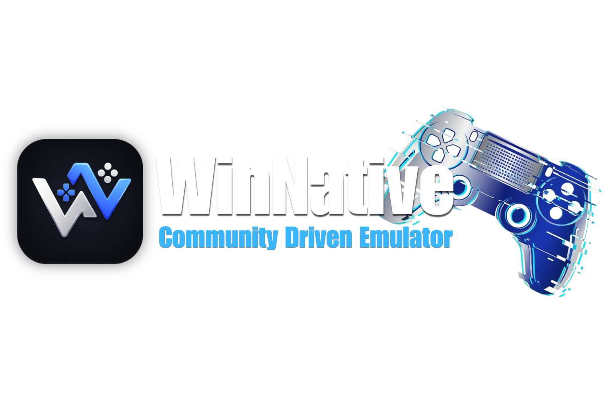

	

# Winlator One

Модифицированная версия [Winlator](https://github.com/brunodev85/winlator) для запуска Windows-приложений и игр (x86/x64 через Wine + Box64), адаптируемая под **OnePlus 13** (Snapdragon 8 Elite / Adreno 830, Android 16, без root).

> **Статус: Этап 1 — основа проекта.** Сейчас это Winlator 11.2 без функциональных изменений, собираемый в GitHub Actions. Новая система управления, графические профили и игровая библиотека — в планах (см. ниже). Ничего не объявляется готовым до проверки на устройстве.

## Скачать APK

**Actions → Build APK →** последний успешный запуск **→ Artifacts**. Подробности, подпись и установка: [docs/BUILDING.md](docs/BUILDING.md).

⚠️ Использует тот же package name, что и официальный Winlator (`com.winlator`), поэтому **не ставится рядом с ним** — официальный нужно удалить. Причина — в [исследовании](docs/STAGE0_RESEARCH.md#6-технические-риски) (R1).

## Дорожная карта

| Этап | Содержание | Статус |
|---|---|---|
| 0 | Исследование upstream и Frost, ограничения Adreno 830 / OxygenOS 16 — [отчёт](docs/STAGE0_RESEARCH.md) | ✅ |
| 1 | Форк, CI-сборка APK, постоянная подпись | 🔄 ждёт первой CI-сборки и проверки установки |
| 2 | Графика на OnePlus 13: тест-матрица драйверов, профили, авто-откат | ⏳ |
| 3 | Управление: режимы A (клавиатура+мышь), B (сенсор), C (геймпад), D (геймпад→КБМ), редактор | ⏳ |
| 4 | Игровая библиотека и мобильный интерфейс | ⏳ |
| 5 | Тестирование | ⏳ |

## Ветки

* `main` — Winlator One.
* `upstream-main` — нетронутый upstream `brunodev85/winlator-app` для синхронизации и отката.

## Лицензия и авторы

LGPL-2.1, как и оригинал — см. [LICENSE](LICENSE) и [NOTICE.md](NOTICE.md). Изменения — [CHANGELOG-ONE.md](CHANGELOG-ONE.md).

Winlator создан [BrunoSX (brunodev85)](https://github.com/brunodev85). Сторонние компоненты:

- GLIBC Patches by [Termux Pacman](https://github.com/termux-pacman/glibc-packages)
- Wine ([winehq.org](https://www.winehq.org/))
- Box86/Box64 by [ptitseb](https://github.com/ptitSeb)
- Mesa (Turnip/Zink/VirGL) ([mesa3d.org](https://www.mesa3d.org))
- DXVK ([github.com/doitsujin/dxvk](https://github.com/doitsujin/dxvk))
- VKD3D ([gitlab.winehq.org/wine/vkd3d](https://gitlab.winehq.org/wine/vkd3d))
- CNC DDraw ([github.com/FunkyFr3sh/cnc-ddraw](https://github.com/FunkyFr3sh/cnc-ddraw))
